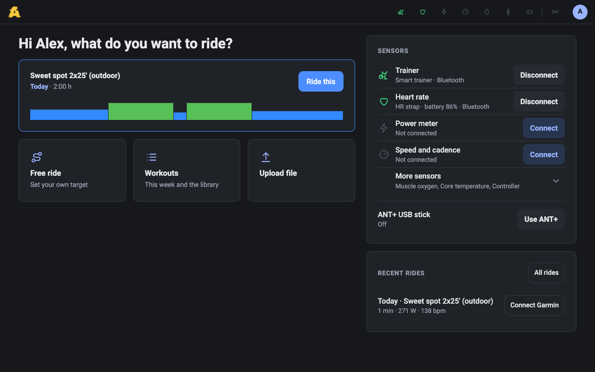
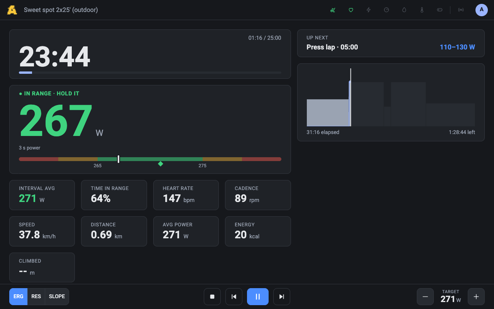
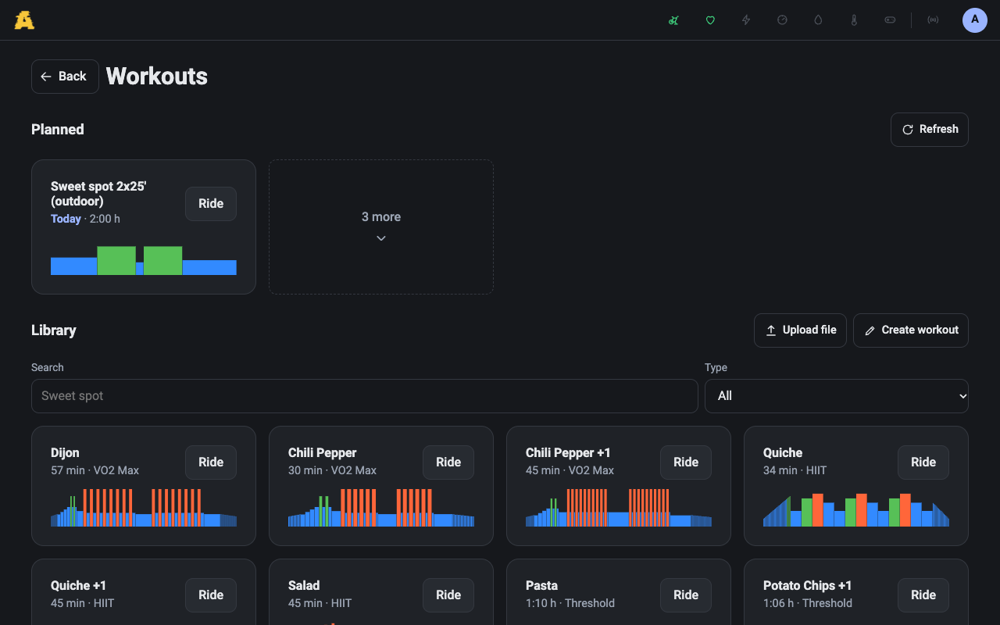
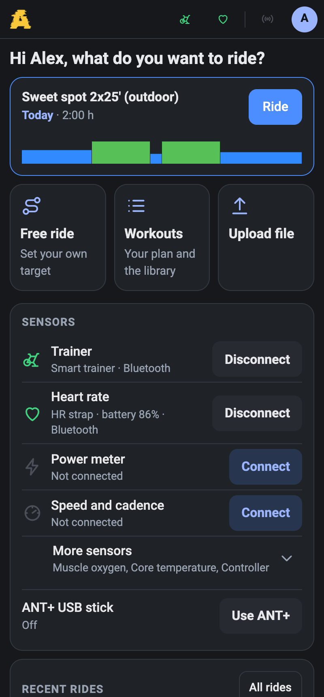
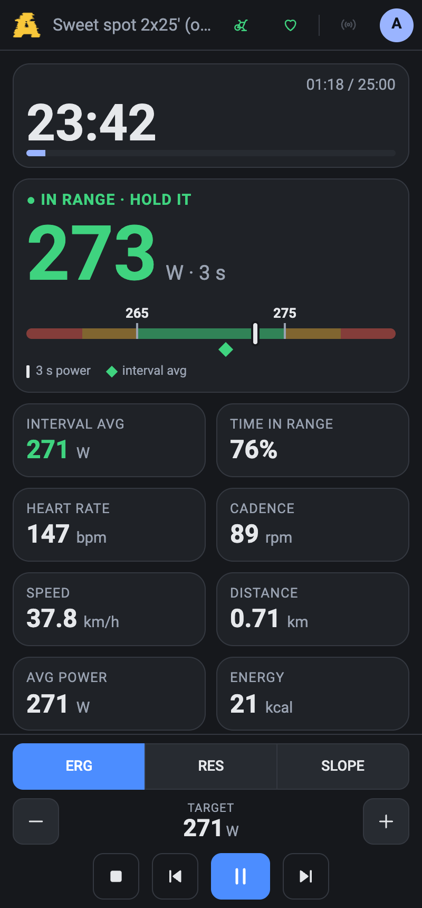
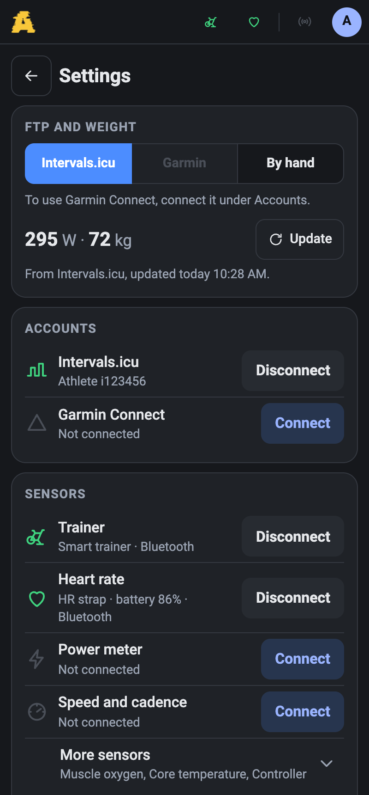

# Auuki, home edition

A personal fork of **[Auuki](https://github.com/dvmarinoff/Auuki)** by Dimitar Marinov
([@dvmarinoff](https://github.com/dvmarinoff)), the browser app for structured indoor
cycling workouts on a smart trainer.

This fork runs Auuki on a small server at home: several riders share one setup, each
with their own Intervals.icu and Garmin Connect accounts, and rides are stored on that
server. The interface is redesigned around picking a rider, connecting sensors and
riding.

> [!NOTE]
> This is a modified version of Auuki and is **not** the official app, not affiliated with
> or endorsed by the Auuki project or [auuki.com](https://auuki.com). Please report
> problems with this fork here, not upstream. The name Auuki and its logo belong to the
> original project. For the official app, go to [auuki.com](https://auuki.com).



## What this fork changes

Everything Auuki does stays: .zwo workouts, Bluetooth trainers and sensors, ERG,
resistance and slope modes, .FIT recording. On top of that:

- **Riders**: a "Who's riding?" screen, each rider with an optional PIN.
- **Accounts per rider**: Intervals.icu (planned workouts, upload) and Garmin Connect
  (upload). API keys and tokens stay on the server, the browser never sees them.
- **FTP and weight** from Intervals.icu, Garmin Connect or entered by hand, refreshed
  when the app opens.
- **Rides on the server** as .FIT files, uploaded to Intervals.icu or Garmin on demand.
- **Redesigned interface** for wide screens and phones: a start screen with today's
  workout, a ride screen with a pacing gauge for the target range, sensors and accounts
  in one consistent list, 44 px touch targets.
- **All seven sensor types** in one place: trainer, heart rate, power meter, speed and
  cadence, muscle oxygen, core temperature and controller.





<table>
  <tr>
    <td></td>
    <td></td>
    <td></td>
  </tr>
</table>

The screenshots show a demo rider with simulated sensor data.

## Run it

The app and its API run in one container on http://localhost:8080:

```bash
docker compose up -d --build
```

Riders, accounts and sensors are set up in the app on first start. Data lives in the
`auuki-data` volume. Web Bluetooth needs a secure context: `localhost` works as is, other
devices on the network need HTTPS through a reverse proxy (see
[server/README.md](server/README.md)).

Development:

```bash
npm install
cd server && uv sync && cd ..
(cd server && uv run uvicorn app.main:create_app --factory --port 8080) &
npm start            # http://localhost:1234, /api is proxied to :8080
npm test             # Jest
cd server && uv run pytest
```

The server's endpoints and settings are described in [server/README.md](server/README.md).

## Supported browsers and trainers

From the original project, still true for this fork:

| Chrome | Edge | Opera | Chrome Android | Samsung Internet | Brave | Firefox | Safari | Safari iOS | Chrome iOS |
|--------|------|-------|----------------|------------------|-------|---------|--------|------------|------------|
| yes    | yes  | yes   | yes            | yes              | yes*  | no      | no     | no         | no         |

\* Brave needs [Web Bluetooth turned on](https://community.brave.com/t/can-you-enable-web-bluetooth-api-in-brave/522553/2).
On Linux, the experimental web platform features flag may be needed
(`chrome://flags/#enable-experimental-web-platform-features`).

Trainers work over Bluetooth FTMS, Tacx FE-C over BLE or Wahoo CPS, which covers most
smart trainers since 2020. ANT+ through a USB stick is experimental. See the
[original README](https://github.com/dvmarinoff/Auuki#supported-trainers) for details.

## Credits and license

Auuki is © Dimitar Marinov and its contributors, licensed under the
[GNU Affero General Public License v3.0](LICENSE.txt). This fork is a modified version,
changed from November 2026 on by Moritz Hoferer, and is released under the same license.
The changes are visible in this repository's history.

Under the AGPL, anyone you let use a hosted copy over a network must be able to get its
source. The app links to this repository under Settings. If you host a changed version
for others, point that link to your source.

If you like Auuki, support the original project on
[GitHub Sponsors](https://github.com/sponsors/dvmarinoff).
